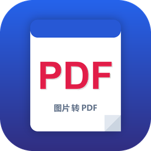

<div align="center">

# 📄 图片转高质量 PDF · 汉化版



### 把一堆图片，一键变成漂亮的 PDF。

> 🌏 **中文界面 · 开箱即用**
> 既能**把所有图片合并成一个 PDF**，也能**每张图片各自成一个 PDF**，还能把 **PDF 翻回图片**。

</div>

---

## ✨ 为什么值得用

| 你想做的事 | 它都能做 |
|---|---|
| 两张证书/合同/文档图，合成一个 PDF | ✅ 合并为单个 PDF（多页） |
| 一批照片，每张单独出一个 PDF | ✅ 每张图片单独一个 PDF |
| 批量选图、排序、改质量 | ✅ 批量 + 上移/下移/按名称排序 |
| 要把 PDF 每页拿回成图片 | ✅ PDF → PNG / JPG |

- **无损高质量**：默认走 `img2pdf`，保持原图编码，不二次压缩；也能选高质量 JPEG / 无损 PNG。
- **本地运行，不上传**：所有处理都在你电脑上完成，隐私放心。
- **中文界面**：按钮、选项、状态提示全部中文，一看就会。

---

## 🖼️ 支持的图片格式

PNG · JPG/JPEG · BMP · GIF · TIF/TIFF · WEBP

---

## 🚀 快速开始

需要 **Windows** 和 **Python 3.8+**。

```powershell
# 1) 创建虚拟环境并安装依赖（首次）
python -m venv .venv
.\.venv\Scripts\python.exe -m pip install -r requirements.txt

# 2) 启动应用
.\.venv\Scripts\python.exe Photo-PDF-Bidirectional-Converter.py
```

> Windows 下也可直接双击项目里的 **`启动.bat`**。

---

## 🧭 使用步骤

1. 点 **添加…**，选择一张或多张图片。
2. 在右侧选择导出方式：
   - **合并为单个 PDF（多页）** → 选一个输出文件。
   - **每张图片单独一个 PDF** → 选一个输出文件夹。
3. （可选）调整页面尺寸、DPI、边距、嵌入方式、JPEG 质量。
4. 点 **转换**，完成。

---

## 🙏 致谢与版权

本项目是 **[SagarBiswas-MultiHAT/Photo-PDF-Bidirectional-Converter](https://github.com/SagarBiswas-MultiHAT/Photo-PDF-Bidirectional-Converter)** 的**中文汉化版**。

- **原作者**：Sagar Biswas
- **原项目**：<https://github.com/SagarBiswas-MultiHAT/Photo-PDF-Bidirectional-Converter>
- **协议**：MIT（详见 `LICENSE`）

转换逻辑、功能与质量完全保留自原项目；**此仓库所做的修改仅为界面中文化与本地启动脚本**。
如果你觉得有用，欢迎去给**原项目**点个 ⭐ 支持原作者。

---

<div align="center">

[](https://www.python.org/)
&nbsp;
[](LICENSE)
&nbsp;
[]()
&nbsp;
[]()

</div>
